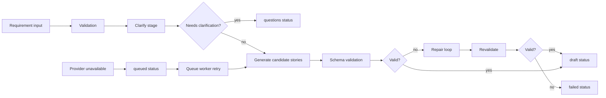
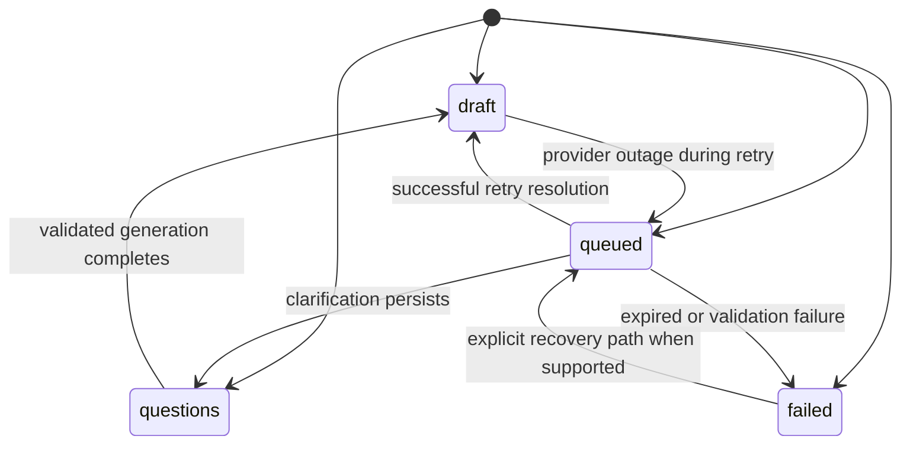

# Story Agent system design

## 1. Goals

- accept a product requirement and decide whether it is a valid draft, requires clarification, or must be queued because provider capacity is unavailable;
- generate a small set of focused user-story outputs with bounded validation and repair;
- preserve a durable conversation history across restarts and queued retries;
- keep provider failure handling explicit, bounded, and recoverable without masking quality checks.

## 2. Non-goals and constraints

- no commercial SaaS or multi-tenant orchestration;
- no redesign of the repository or creation of a second framework;
- no unlimited retry loops or unbounded LLM repair context;
- no claim of semantic completeness beyond the deterministic checks and live-provider evaluation contract.

## 3. Boundaries and responsibilities

- Web client: presents the widget, local chat state, history search, and copy actions.
- API controller: validates input, enforces queue capacity, persists the run document, and returns the status-specific payload.
- Service pipeline: validates intake, gathers contextual titles, runs clarify/generate/repair stages, and enforces budgets.
- Provider router: chooses a configured provider, retries retryable failures, and opens a circuit after repeated failures.
- Repository: persists run documents and drafts for history and restoration.
- Queue worker: reclaims queued runs, re-runs generation, and updates the status with durable metadata.

## 4. Requirement-to-stories flow

## 5. Clarification, generation, validation, repair, and quality gate

The pipeline uses a lightweight quality gate after generation. It verifies that returned stories match the contract, avoid duplicate titles, honor the configured story cap, and preserve a meaningful outcome-based title. Repair is limited to two attempts, and a failed repair path cannot leak partial drafts through a successful response.

The service also enforces token and elapsed-time budgets, and provider refusals are converted into controlled failures instead of partial success states.

## 6. API contracts and run-status transitions

The controller returns `200` for `questions` and `draft`, `202` for `queued`, and `500` for a controlled failure. Persisted runs store the `requirement`, `status`, queue timestamps, `questions`, `stories`, `usage`, `providers`, `validationErrors`, and a `reason`/`error` string when applicable.

## 7. MongoDB persistence and indexes

The feature persists to the Mongo collections `story_agent_runs` and `story_agent_drafts`.

- `story_agent_runs`: stores the run identity, lifecycle status, requirement, optional context, questions, stories, totals, provider list, attempts, stages, validation errors, reason, queue schedule, and timestamps.
- `story_agent_drafts`: stores the runId and final stories for direct retrieval by a selected run.

Indexes include:

- unique `runId` on both collections;
- descending `createdAt` for run history ordering;
- composite `{ status, nextAttemptAt }` for queue processing.

## 8. Provider routing, failover, circuit breaker, and budgets

The provider router selects an OpenAI-compatible provider from configured environment values, tries the next route after retryable failures, and opens a circuit after repeated failure counts. A cooldown window prevents immediate retry storms, while remaining provider issues produce explicit `queued` or `failed` outputs rather than silent fallback.

The service budget is intentionally bounded and includes maximum calls, total tokens, elapsed time, and story count. These constraints are enforced in code so provider outages and rate limits cannot turn into infinite loops.

## 9. Queueing, restart recovery, and expiry semantics

Queued runs are claimed atomically with a lock and next-attempt metadata. If a queued run exceeds the configured retries or its expiry time, it is marked failed with an explicit expired reason. Because the payload is stored before and after queue processing, the restored history remains accurate after a server restart and reflects either a valid draft, clarification questions, a failed result, or a queued/inconclusive state.

## 10. Error handling, security, and secret management

- user input is trimmed and length-bounded before provider access;
- prompt data is wrapped in explicit delimiters to reduce instruction injection risk;
- malformed or structured refusal outputs are converted to controlled errors instead of partial success;
- diagnostics do not leak raw provider output, prompt payloads, or credentials;
- secrets remain configured only in environment values and are not committed into the repository.

## 11. Logging, observability, and evaluation

The service records stages, provider names, usage totals, and reasons for the run. Pino
emits structured local logs with request/trace correlation. OpenTelemetry spans cover
HTTP handling, requirement/context/output validation, generation, provider requests,
queue admission/claim, and run persistence. MongoDB adapter operations have latency and
failure metrics. Metrics use route templates,
provider/model configuration, status classes, queue outcomes, and bounded operation
names; prompts, contexts, generated output, IDs, and raw URLs are not metric labels.
External OTLP export is optional and requires host configuration. Grafana dashboards and
alert templates live in `enablers/observability`; exporter delivery has not been verified
without a configured account. Direct app log shipping to Grafana Loki is not enabled
pending review of a safe field allowlist and destination.

The repository’s deterministic tests are the primary quality gate for contract
correctness, while the live evaluation script is kept separate and only treated as a
meaningful result when a fixture actually ran.

## 12. Testing strategy, current limits, and future improvements

The project includes deterministic fake-provider tests for:

- clarification questions;
- validation and repair;
- budget exhaustion and queue expiry;
- duplicate-title handling;
- multi-story cart/checkout generation;
- history persistence and API mapping.

Current limitations are explicit:

- live-provider quality can still be inconclusive because provider quotas and outages are external conditions;
- the UI does not yet implement an accept/reject workflow or deeper task generation;
- future improvements such as richer traceability, multi-step critique passes, and tool-backed context retrieval remain deliberately out of scope for this implementation.
